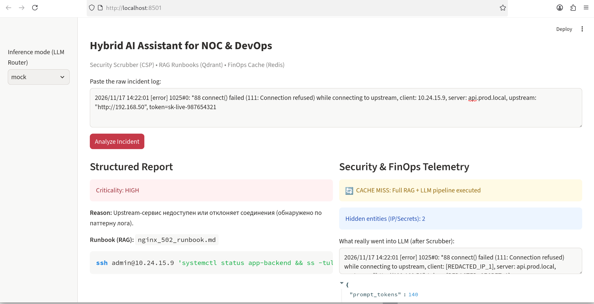
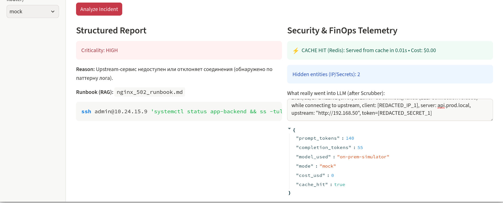

# Hybrid AI Assistant for NOC & DevOps

An enterprise-grade, security-first AI incident triage assistant built for **NOC engineers, DevOps, and SRE teams**. Designed to operate seamlessly across both **Cloud (OpenAI/Azure)** and **Air-Gapped / On-Premise (Ollama)** environments with built-in PII/Secret masking and FinOps cost optimization.

## Project Structure

```text
hybrid_assistant_for_noc_dev_ops/
├── .env.example                 # Environment variables template
├── .gitignore                   # Git exclusions (.env, venv, qdrant_data)
├── docker-compose.yml           # Infrastructure services (Qdrant & Redis)
├── requirements.txt             # Pinned Python dependencies
├── README.md                    # Project documentation and architecture
│
├── knowledge_base/              # Markdown runbooks indexed into Vector DB
│   └── nginx_502_runbook.md     # Standard operating procedure for 502 errors
│   └── k8s_oom_runbook.md       # Kubernetes OOMKilled (Out Of Memory)
├── evals/                       # Automated quality & security regression suite
│   ├── test_cases.json          # Test dataset with dirty logs & expected outputs
│   └── run_eval.py              # CI/CD evaluation script (Security + RAG + Schema)
│
└── app/                         # Application source code (Clean Architecture)
    ├── __init__.py
    ├── main.py                  # FastAPI entry point and orchestration pipeline
    ├── ui.py                    # Streamlit interactive demo dashboard
    │
    ├── core/                    # Configuration & settings
    │   ├── __init__.py
    │   └── config.py            # Pydantic BaseSettings loader
    │
    ├── schemas/                 # Data contracts
    │   ├── __init__.py
    │   └── incident.py          # Strict JSON output schema (IncidentReport)
    │
    └── services/                # Isolated business logic modules
        ├── __init__.py
        ├── scrubber.py          # Zero-Trust PII & secret masking middleware
        ├── rag_engine.py        # Qdrant vector search & runbook indexing
        ├── llm_router.py        # Strategy router (Cloud / Local / Mock)
        └── finops_tracker.py    # Redis caching & token cost telemetry
```

## Architecture & Pipeline

```text
[Raw Incident Log] 
       │
       ▼
1. [DataScrubber Middleware] ──► Masks IPs, Tokens, Passwords ([REDACTED_IP_1])
       │
       ▼
2. [FinOps Redis Cache]      ──► Exact hash lookup (0ms latency, \$0.00 cost)
       │ (Cache Miss)
       ▼
3. [Qdrant Vector RAG]       ──► Retrieves verified Markdown Runbooks
       │
       ▼
4. [Hybrid LLM Router]       ──► Routes to Local (Ollama) or Cloud (OpenAI) + Pydantic Structured Output
       │
       ▼
5. [Unmask & Response]       ──► Restores real IPs in read-only CLI diagnostic commands
```
## Live Demo Preview

### 1. Zero-Trust PII & Secret Masking + Grounded RAG


### 2. FinOps Redis Cache Hit ($0.00 Latency & Cost)



## Key Engineering Features

* **Zero-Trust Data Scrubber (`app/services/scrubber.py`):** Regex-based middleware intercepts sensitive infrastructure data (IPv4, API keys, passwords) *before* leaving the perimeter, restoring placeholders only in memory for the final operator output.
* **Hybrid Inference Router (`app/services/llm_router.py`):** Strategy-pattern router allowing instant switching between cloud APIs, local on-premise models, and offline simulation mode without changing business logic.
* **Grounded RAG (`app/services/rag_engine.py`):** Uses **Qdrant** to ground LLM responses in internal Markdown runbooks, eliminating hallucinations and enforcing strict JSON schemas via **Pydantic**.
* **FinOps Telemetry & Caching (`app/services/finops_tracker.py`):** Tracks token usage, estimates USD cost per incident, and caches recurring alert storms in **Redis**.
* **Automated Evals (`evals/run_eval.py`):** Regression test suite verifying zero secret leakage and retrieval accuracy.

## Quick Start (Local Setup)

### 1. Start Infrastructure (Qdrant & Redis)
```bash
docker compose up -d
```

### 2. Install Python Dependencies
```bash
python3 -m venv venv
source venv/bin/activate
pip install -r requirements.txt
cp .env.example .env
```

### 3. Run Backend & Demo UI
Open two terminal tabs:
```bash
# Terminal 1: FastAPI Backend
uvicorn app.main:app --reload

# Terminal 2: Streamlit Dashboard
streamlit run app/ui.py
```

### 4. Run Automated Quality & Security Evals
```bash
python3 evals/run_eval.py
```
